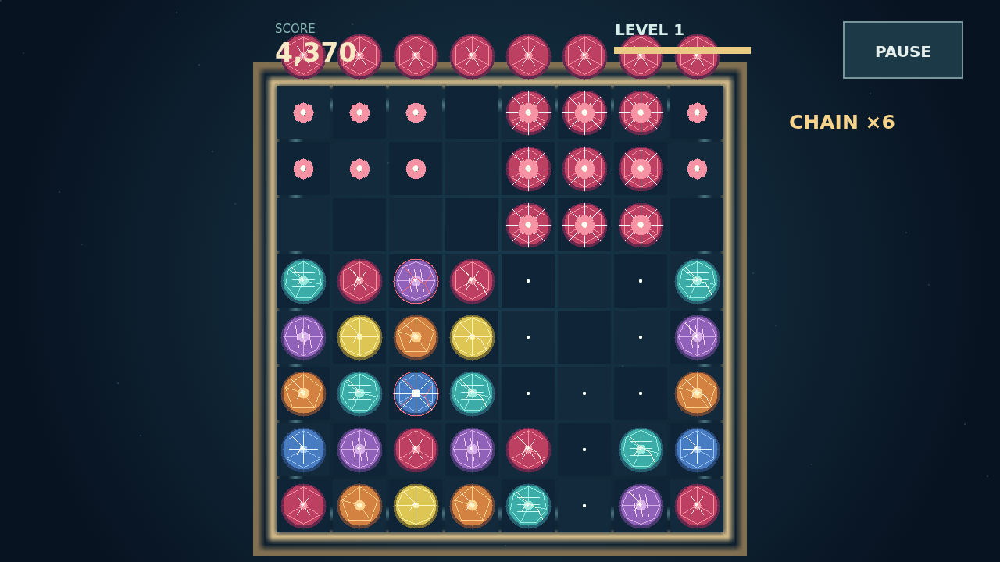

# Facet

A lit field of cut stones waits for one good move. Take hold of a gem, carry it onto a neighbor, and let go. Three of a kind shatter; what falls into the gaps may make another line, then another, with every step worth more.

The board remembers each clear. Stones beside the break take strain. Push one far enough and it becomes flawed: the next clear that touches it pulls it in, doubling its value and often opening a path through a crowded corner.

Long lines leave gifts behind. Four makes a brilliant that clears its surrounding ring. Five makes a prism that can sweep away a whole kind. Cross two lines and a star is born, ready to take its row and column. Work these cuts into the strained parts of the board and watch the chain climb.

Reach the score target to open the next level. The round lasts as long as a shattering swap remains.

